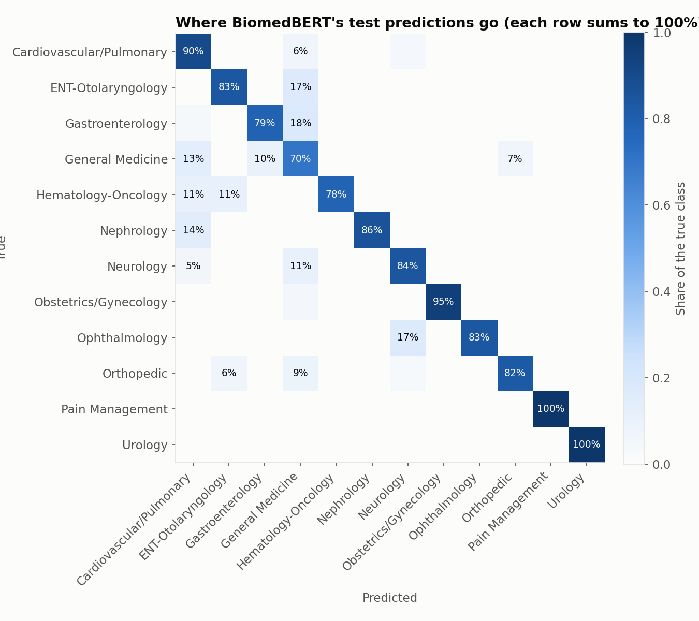
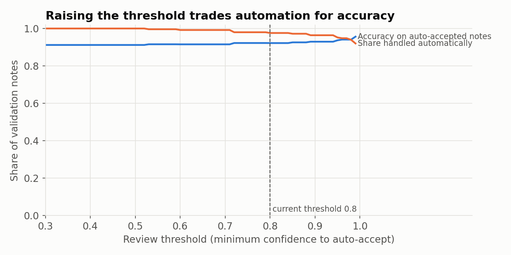
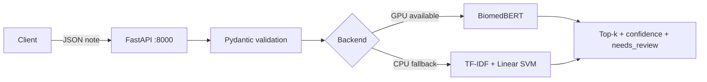

# Medical Text Classifier


An end-to-end clinical NLP service that reads a medical transcription note and predicts its medical specialty (12 classes), with a confidence score, the top-3 alternatives and a flag that routes uncertain notes to a human reviewer.

The project covers the full lifecycle: label cleaning and leakage-safe splitting, a classic TF-IDF baseline, frozen sentence embeddings, transformer fine-tuning, a controlled model comparison, held-out evaluation with bootstrap confidence intervals, threshold tuning, a REST API with a CPU fallback, tests, Docker and CI.

```
POST /predict  {"text": "<an obstetrics note from the test set>", "top_k": 3}

{
  "specialty": "Obstetrics / Gynecology",
  "confidence": 0.9977,
  "needs_review": false,
  "top_k": [
    {"label": "Obstetrics / Gynecology", "score": 0.9977},
    {"label": "Hematology - Oncology", "score": 0.0004},
    {"label": "Nephrology", "score": 0.0003}
  ],
  "backend": "biomedbert",
  "latency_ms": 9.3
}
```

---

## Results at a glance

| Metric (held-out test set, 250 notes) | TF-IDF + SVM | **BiomedBERT (fine-tuned)** |
| --- | --- | --- |
| Macro-F1 | 0.818 | **0.874** |
| 95% bootstrap CI | 0.752 to 0.865 | 0.827 to 0.913 |
| Accuracy | 0.820 | **0.852** |
| Latency per note, CPU | **0.4 ms** | 175 ms |
| Latency per note, GPU (RTX 4060 Laptop) | n/a | 15 ms |

- BiomedBERT beat the TF-IDF baseline in 97% of paired bootstrap resamples (95% CI of the difference: -0.004 to 0.127): very likely better, not proven at 95% on 250 notes.
- At a review threshold of 0.95 (chosen on validation), about 5% of notes go to a human and accuracy on auto-accepted notes rises from 0.912 to 0.937.

| | |
| --- | --- |
|  |  |
|  |  |

---

## Architecture



- **`classifier.py`** holds all model logic: backend selection, scoring, top-k and the review flag.
- **`app.py`** handles HTTP only: validation, the lifespan start-up (model load and warm-up) and response schemas.
- Configuration comes from environment variables (`BACKEND`, `MODEL_DIR`, `TFIDF_PATH`), so the same code runs locally, in Docker and in tests.

### Endpoints

| Method | Path | Purpose |
| --- | --- | --- |
| GET | `/health` | Status, active backend, device, number of classes, review threshold |
| GET | `/classes` | The 12 specialties |
| POST | `/predict` | `{"text": ..., "top_k": 3}` returns specialty, confidence, top-k, needs_review, backend, latency |
| GET | `/docs` | Interactive Swagger documentation |

Invalid input (blank or very short text, text over 50,000 characters, `top_k` outside 1 to 12) returns HTTP 422. Note text is never logged.

---

## Quick start

Requires [Docker Desktop](https://www.docker.com/products/docker-desktop/).

```bash
git clone https://github.com/rakshitha-hm/medical-text-classifier.git
cd medical-text-classifier
docker build -t medical-text-classifier .
docker run -p 8000:8000 medical-text-classifier
```

Open http://localhost:8000/docs. The image ships with the TF-IDF model, so it runs on any machine.

**With BiomedBERT:** the fine-tuned weights (about 420 MB) are not stored in git. Train them with `src/finetune.py` (see below) so they are in `models/biomedbert/`, then:

```bash
docker compose up --build
```

Compose mounts `models/biomedbert` read-only and sets `BACKEND=transformer` (about 175 ms per note on CPU).

---

## Dataset

[Medical Transcriptions (Kaggle)](https://www.kaggle.com/datasets/tboyle10/medicaltranscriptions): 4,999 sample notes from MTSamples, in English. See the dataset page for its license. The data is not included in this repository.

Data preparation ([src/prepare_data.py](src/prepare_data.py)) was the most important step:

| Problem found in EDA | Decision |
| --- | --- |
| Some "specialties" are document types (Discharge Summary, SOAP / Progress Notes, Letters, ...) | Removed: they describe the note format, not the specialty |
| The same note appears under several specialties | Deduplicated before splitting, to prevent train/test leakage |
| A first rule that resolved duplicates alphabetically silently biased labels (Radiology lost to Neurology) | Replaced by an explicit priority rule: generic classes (Surgery, Radiology, General Medicine) yield to a specific specialty; 319 notes with two specific labels dropped |
| Long-tail classes with very few notes | Classes under 50 notes removed |

**Result:** 1,665 unique notes, 12 classes, stratified 1,165 / 250 / 250 split, with an assertion that no text appears in two splits.

---

## Modelling journey

Each step changed one thing and was compared on the same validation set; the test set was used once at the end.

| Step | Model | Val macro-F1 | Test macro-F1 | Lesson |
| --- | --- | --- | --- | --- |
| Baseline | TF-IDF (1-2 grams) + Linear SVM | 0.874 | 0.818 | A strong, explainable keyword baseline |
| Frozen embeddings | MiniLM / PubMedBERT + Logistic Regression | 0.852 / **0.882** | | Domain pretraining helps; chunking long notes beats truncation |
| Fine-tuning | DistilBERT (general domain) | 0.829 | 0.843 | Fine-tuning alone did not beat the baseline |
| Fine-tuning | **BiomedBERT (biomedical)** | **0.91** | **0.874** | Same settings, only the pretrained model changed: +0.08 macro-F1 |

Key findings:

- **Domain pretraining mattered more than fine-tuning.** Biomedical models won both frozen and fine-tuned.
- **Error analysis showed a taxonomy problem.** About half of the baseline's errors were predicted as General Medicine, a catch-all class whose top features are generic exam words. BiomedBERT still scores lowest on it (F1 0.63).
- **Small-sample noise is real.** TF-IDF and DistilBERT swapped places between validation and test; only large gaps were trusted, and all test scores are reported with bootstrap intervals.
- **The model is over-confident.** Training loss went almost to zero while validation loss rose after epoch 3, and most remaining errors are made with over 95% confidence, so the review flag catches about a third of them.

See [docs/MODEL_CARD.md](docs/MODEL_CARD.md) for intended use, limitations and ethical considerations.

---

## Testing and CI

```bash
pip install torch --index-url https://download.pytorch.org/whl/cpu
pip install -r requirements-dev.txt
pytest -v
```

- 13 tests: softmax, backend selection, top-k ordering, the response contract and 6 invalid-input cases.
- Tests train a tiny 3-class TF-IDF model on the fly, so they need no GPU, dataset or large model.
- GitHub Actions runs the tests on every push and pull request, then builds the Docker image only if they pass.

---

## Reproduce the pipeline

```bash
python -m venv .venv
.venv\Scripts\activate                     # Windows
# Install PyTorch first (CUDA or CPU) from https://pytorch.org/get-started/locally/
pip install -r requirements-dev.txt
pip install pandas matplotlib sentence-transformers accelerate

python src/prepare_data.py                 # clean, deduplicate, split
python src/baseline.py                     # TF-IDF baselines
python src/inspect_baseline.py             # confusion pairs and top words
python src/embeddings.py                   # frozen embeddings
python src/finetune.py --model microsoft/BiomedNLP-BiomedBERT-base-uncased-abstract-fulltext --name biomedbert
python src/evaluate.py                     # test set, bootstrap CIs, latency
```

Run the API locally:

```bash
python -m uvicorn app:app --app-dir src
python src/client_check.py
```

---

## Project structure

```
medical-text-classifier/
├── src/
│   ├── prepare_data.py       # cleaning, label rules, dedup, stratified split
│   ├── baseline.py           # TF-IDF + NB / LR / SVM
│   ├── inspect_baseline.py   # confusion pairs, top words per class
│   ├── embeddings.py         # MiniLM / PubMedBERT, truncate vs chunk
│   ├── finetune.py           # Hugging Face Trainer fine-tuning
│   ├── evaluate.py           # test set, bootstrap CIs, latency
│   ├── classifier.py         # model wrapper, backend selection, review flag
│   ├── app.py                # FastAPI service
│   └── client_check.py       # API smoke test
├── notebooks/                # EDA, duplicates, results charts
├── tests/                    # pytest suite
├── docs/                     # charts, MODEL_CARD.md
├── models/tfidf_baseline.joblib
├── Dockerfile
├── docker-compose.yml
└── .github/workflows/ci.yml
```

---

## Limitations and next steps

- **Calibration:** add label smoothing and earlier stopping, then temperature scaling, and re-tune the review threshold.
- **Long notes:** inputs are truncated at 512 tokens; try head + tail truncation, chunk-level pooling or a long-context model.
- **General Medicine:** revisit the label definition with clinicians, or treat it as a fallback class.
- **Robustness:** average several seeds and evaluate on a larger, external dataset before any real use.
- **Serving:** a GPU image or an optimised model (ONNX, quantisation, distillation) for faster CPU inference.

Not for clinical decision-making.

---

## Tech stack

Python, pandas, scikit-learn, PyTorch, Hugging Face Transformers, sentence-transformers, FastAPI, Pydantic, Uvicorn, pytest, Docker, Docker Compose, GitHub Actions, matplotlib.