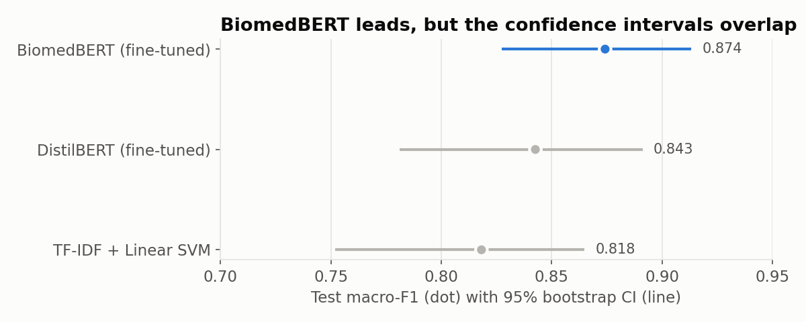
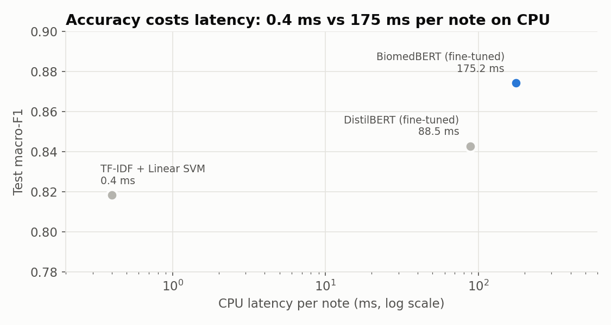

# Medical Text Classifier


An end-to-end clinical NLP service that predicts the medical specialty of a transcription note (12 classes), with a confidence score, top-3 suggestions and a flag that routes uncertain notes to a human reviewer.

## Results (held-out test set, 250 notes)

| Model | Macro-F1 | 95% CI | CPU ms/note | GPU ms/note |
| --- | --- | --- | --- | --- |
| TF-IDF + Linear SVM | 0.818 | 0.75 to 0.87 | 0.4 | n/a |
| DistilBERT, fine-tuned | 0.843 | 0.78 to 0.89 | 89 | 9 |
| **BiomedBERT, fine-tuned** | **0.874** | **0.83 to 0.91** | 175 | 15 |

| | |
| --- | --- |
|  |  |

**Highlights**

- **Data cleaning mattered most:** removed document-type labels, deduplicated notes before splitting to prevent leakage, and replaced an alphabetical tie-break that silently biased labels with an explicit priority rule.
- **Domain pretraining won:** with identical training settings, BiomedBERT beat DistilBERT by 0.08 macro-F1 on validation. Fine-tuning a general model didn't beat the TF-IDF baseline.
- **Honest evaluation:** test scores come with bootstrap confidence intervals. BiomedBERT beat TF-IDF in 97% of paired resamples.
- **Human-in-the-loop:** a review threshold of 0.95, tuned on validation, sends about 5% of notes to a human and raises accuracy on the rest from 0.912 to 0.937.

## How it works

1. **Data:** 4,999 Kaggle notes cleaned to 1,665 unique notes and 12 classes, then a stratified 1,165 / 250 / 250 split.
2. **Models:** TF-IDF baselines, then frozen sentence embeddings (MiniLM, PubMedBERT), then fine-tuned DistilBERT and BiomedBERT, changing one thing at a time.
3. **Evaluation:** the test set is used once, with bootstrap CIs, a paired comparison and latency on CPU and GPU.
4. **Serving (FastAPI):** BiomedBERT on GPU, with an automatic TF-IDF fallback on CPU. The response includes top-k, confidence and `needs_review`.

## API

| Method | Path | Purpose |
| --- | --- | --- |
| GET | `/health` | Backend, device, classes, review threshold |
| GET | `/classes` | The 12 specialties |
| POST | `/predict` | `{"text": "...", "top_k": 3}` returns specialty, confidence, top-k, needs_review |
| GET | `/docs` | Swagger documentation |

## Quick start

```bash
git clone https://github.com/rakshitha-hm/medical-text-classifier.git
cd medical-text-classifier
docker build -t medical-text-classifier .
docker run -p 8000:8000 medical-text-classifier
```

Open http://localhost:8000/docs. The image ships with the TF-IDF model. To serve BiomedBERT, train it with `src/finetune.py`, then run `docker compose up --build`.

## Testing and CI

```bash
pip install torch --index-url https://download.pytorch.org/whl/cpu
pip install -r requirements-dev.txt
pytest -v
```

The 13 tests run on a tiny model trained on the fly, so they need no GPU or dataset. GitHub Actions runs them on every push, then builds the Docker image.

## Limitations

- **Over-confident:** most errors are made at over 95% confidence. Label smoothing and temperature scaling are the next steps.
- **General Medicine** is a catch-all class and the weakest (F1 0.63).
- Notes are truncated at 512 tokens, and the test set is small (250 notes).

See [docs/MODEL_CARD.md](docs/MODEL_CARD.md) for intended use and limitations. Not for clinical decision-making.

## Stack

Python, pandas, scikit-learn, PyTorch, Hugging Face Transformers, sentence-transformers, FastAPI, Docker, pytest, GitHub Actions.

Dataset: [Medical Transcriptions (Kaggle)](https://www.kaggle.com/datasets/tboyle10/medicaltranscriptions), not included in the repo.